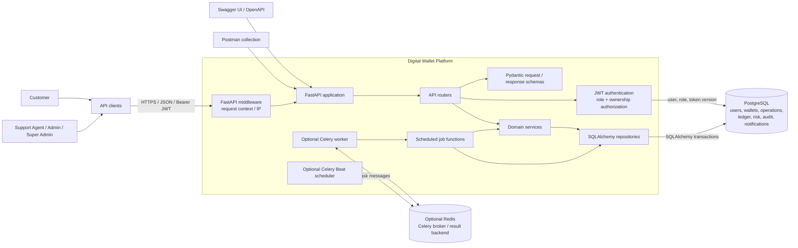
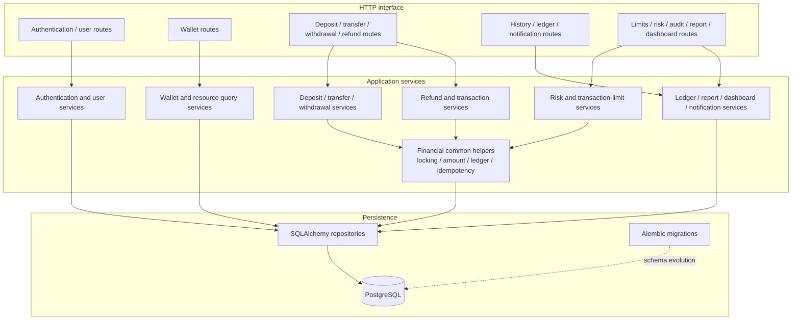
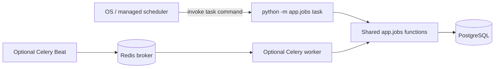

# System Architecture

This document describes the current implementation architecture of the Digital Wallet & Transaction Processing Platform. The diagrams distinguish the normal synchronous API path from optional scheduled processing; they do not imply external payment, email, SMS, or push integrations.

## System context and runtime components



In the deployed runtime, FastAPI handles HTTP requests synchronously. Protected routes use bearer JWT authentication followed by role and resource-ownership checks. Pydantic schemas validate and serialize the API contract. Services implement business rules and transaction boundaries; repositories encapsulate database access. PostgreSQL is the source of truth for balances and operation state.

Celery/Redis integration is optional. When configured and launched, Celery Beat schedules tasks for the worker. The same job functions can instead be called by an external system scheduler through `python -m app.jobs <task>`. The worker and scheduler use the same PostgreSQL database as the API.

## Financial operation path

```mermaid
sequenceDiagram
    autonumber
    actor Client
    participant API as FastAPI route
    participant Guard as Auth / authorization
    participant Service as Financial service
    participant DB as PostgreSQL

    Client->>API: POST financial operation + bearer token + Idempotency-Key
    API->>Guard: Validate token, active user, role and resource ownership
    Guard-->>API: Authorized user
    API->>Service: Validated request data
    Service->>DB: Begin database transaction
    Service->>DB: Lock acting user; check idempotency key and limits
    Service->>DB: Lock wallet row(s) in stable ID order
    Service->>DB: Verify state, currency, balance and business rules
    alt Validation or business rule fails
        Service->>DB: Roll back financial changes; record applicable failure audit
        Service-->>API: Domain error
        API-->>Client: Structured JSON error
    else Operation accepted
        Service->>DB: Update balances and operation state
        Service->>DB: Append immutable ledger entry/entries
        Service->>DB: Add audit, notification and idempotency records
        Service->>DB: Commit
        Service-->>API: Operation result
        API-->>Client: JSON resource response
    end
```

The user and wallet row locks serialize relevant concurrent operations. The database transaction commits balance changes and corresponding ledger records atomically. Idempotency uniqueness constraints protect retries. Database checks prevent negative balances and invalid ledger amounts. The ledger and audit records are append-only in PostgreSQL, enforced by migration-installed triggers.

### Transfer, refund, and risk review

- Transfers debit the sender and credit the receiver within one transaction and append paired `TRANSFER_DEBIT` / `TRANSFER_CREDIT` entries.
- A sender requests a refund using their original outgoing debit ledger ID. After staff approval, settlement locks the transfer and wallets, debits the recipient, credits the sender, and appends paired refund ledger entries.
- Risk blocking a completed transfer uses compensating `REVERSAL` ledger entries instead of editing the original transaction or ledger rows.
- Refund settlement and transfer risk blocking coordinate through database locks and refund-state checks to prevent a second funds movement. A completed refund resolves its linked suspicious case to `NORMAL`; a rejected refund leaves that case open.

## Domain and persistence layers



Important persisted concerns include:

- **Identity:** users, role catalog, refresh-token revocation and token version.
- **Wallet and operation state:** wallets, deposits, transfers, withdrawals and refunds.
- **Financial record:** immutable transaction ledger and shared financial identifiers.
- **Reliability and controls:** idempotency keys, configured transaction limits, suspicious-transaction reviews, audit logs, notifications, wallet daily summaries, and daily reset checkpoints.
- **Outbox:** an outbox event model and persistence helpers exist, but the current scheduled task list does not include an outbox dispatcher. Do not treat external event delivery as active.

## Scheduled and background work



Available job names:

| Job | Purpose |
|---|---|
| `reset-daily-limits` | Record the UTC daily reset checkpoint |
| `cleanup-pending` | Expire stale pending operations/refunds and notify requesters |
| `scan-suspicious` | Find completed operations that meet configured risk signals |
| `daily-wallet-summary` | Persist daily wallet balance snapshots |
| `retry-failed` | Retry eligible failed operations that have no ledger posting |
| `process-approved-refunds` | Settle refunds durably marked approved |
| `daily-report` | Generate daily transaction report data |

Use one scheduling mechanism for each task in a deployment to avoid unnecessary duplicate executions. Tasks are implemented to use database state and locking/checkpoints where needed to handle repeated scheduler invocations safely.

## Operational boundaries

- Deposits and withdrawals are simulations; there is no payment-provider integration.
- Notifications are persisted in the database and exposed by the authenticated API; email, SMS, and push delivery are not configured.
- PostgreSQL is required for production row-lock concurrency guarantees. SQLite is used for the portable automated test suite.
- JWT secrets, PostgreSQL credentials, and bootstrap credentials must be supplied through private environment configuration or a secret manager, not committed to source control.
- For the relational entities, keys, and table-level relationships, see the [ER diagram](ER_DIAGRAM.md). For HTTP operations, see the [API documentation](API_DOCUMENTATION.md).
