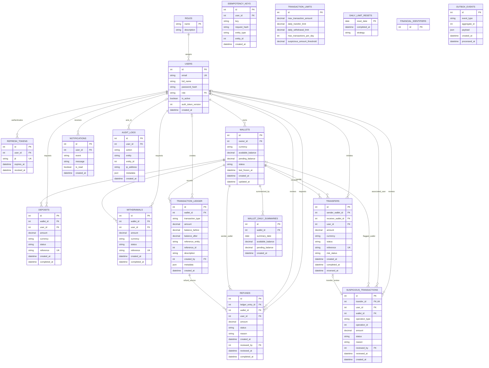

# Entity-Relationship Diagram

This diagram documents the current SQLAlchemy relational schema. `PK` is a primary key, `FK` is a database foreign key, and `UK` is a unique constraint. Mermaid renders the diagram in GitHub and compatible Markdown viewers.

## Relationship and integrity notes

- Each user has one role and may own multiple wallets. The database enforces one wallet per owner and currency.
- Idempotency keys are unique per user/key pair. Daily wallet summaries are unique per wallet/date pair.
- Deposits and withdrawals reference both the wallet affected and the user who initiated the operation. Transfers reference the initiating user and two wallets, with separate sender and receiver foreign keys.
- Every ledger row belongs to one wallet. `created_by` is nullable for system-generated entries. Ledger records are append-only; corrections are represented by compensating entries.
- A refund references the sender's original `TRANSFER_DEBIT` ledger row, the sender wallet, and the requesting user. `reviewed_by` is nullable until a staff decision is recorded.
- A suspicious transaction may refer to a transfer through `transfer_id`, or represent a generic financial operation through the `operation_type` / `operation_id` pair. A unique constraint prevents more than one case per operation.
- Several references are intentionally polymorphic and therefore are **not** database foreign keys: `TRANSACTION_LEDGER.reference_entity` / `reference_id`, `AUDIT_LOGS.entity` / `entity_id`, `IDEMPOTENCY_KEYS.entity_type` / `entity_id`, `SUSPICIOUS_TRANSACTIONS.operation_type` / `operation_id`, and `OUTBOX_EVENTS.aggregate_id`. Their target is identified by the accompanying entity/type field.
- Financial-operation IDs and ledger IDs are allocated from `FINANCIAL_IDENTIFIERS`; the allocator relationship is implemented in application/database logic and is not expressed as a foreign key.
- `TRANSACTION_LIMITS` stores system configuration and `DAILY_LIMIT_RESETS` stores idempotent scheduler checkpoints; neither has a direct relational foreign key to user or wallet data.
- Wallet balances are `NUMERIC(18,2)` and protected by nonnegative database checks. Financial amounts use decimal arithmetic. Enum-like values are shown as `string` in the diagram; their allowed values are enforced by SQLAlchemy enum columns and API schemas.

## Source of truth

The diagram reflects the ORM metadata loaded by `app.models`. If schema migrations or model definitions change, update this document to match and verify the resulting database schema with Alembic.
