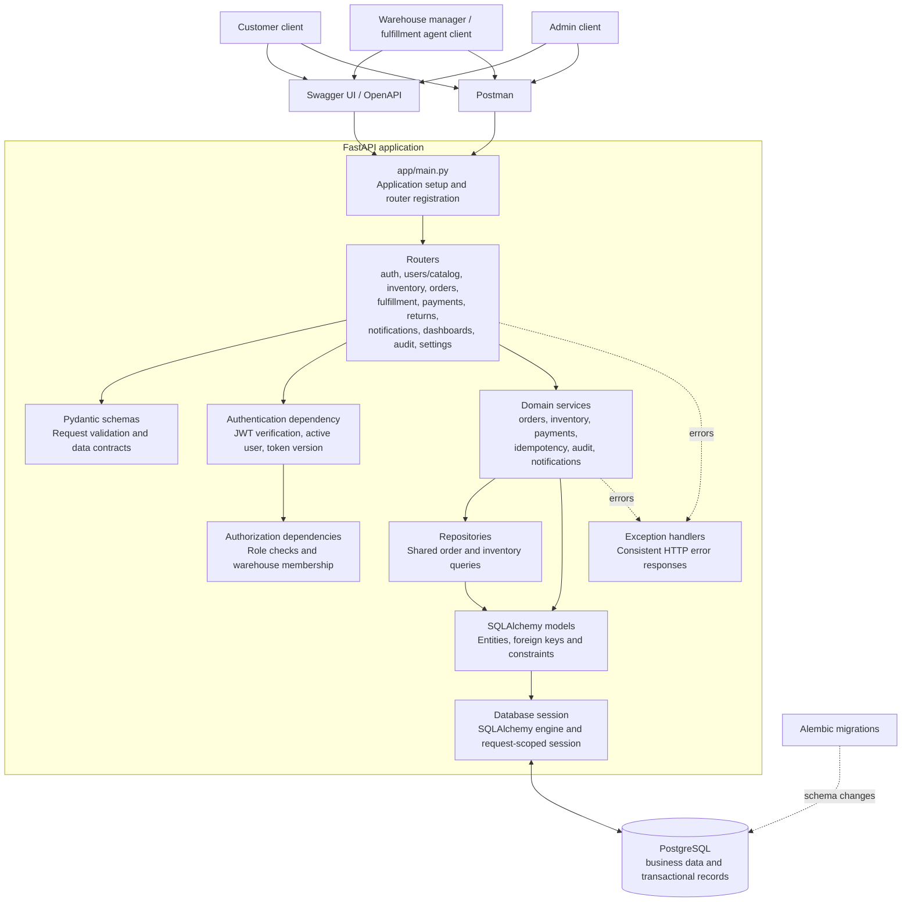
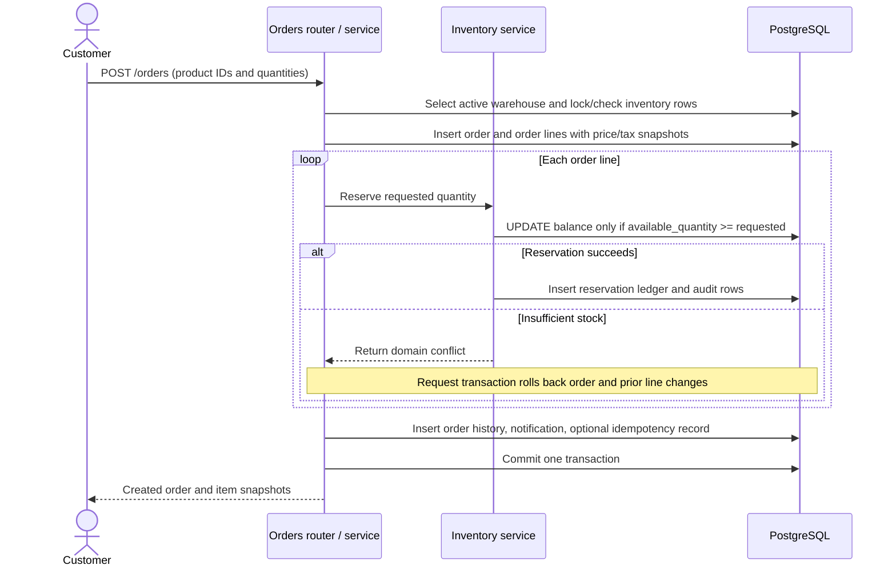

# System Architecture

This is the architecture of the implemented Order Fulfillment & Inventory
Management Platform. It is a modular monolithic REST API: the modules run in
one FastAPI application and share one SQLAlchemy session and relational
database. Mermaid-capable Markdown viewers render the diagrams.

## Component architecture



### Component responsibilities

- **FastAPI routers** expose the HTTP endpoints and coordinate validation,
  authorization, domain operations, and commits.
- **Pydantic schemas** validate incoming request bodies and define typed API
  inputs and outputs.
- **Authentication** decodes the access JWT and checks that its user still
  exists, is active, and has the current token version.
- **Authorization** applies role rules and checks warehouse membership before
  warehouse-scoped actions.
- **Domain services** implement order and return state machines, inventory
  reservation and transfer, pricing/tax snapshots, assignment, and payment
  demo behavior. Shared helpers write audit and notification rows.
- **Repositories** hold reusable database queries. SQLAlchemy models define the
  relational entities and constraints.
- **Database sessions** are created per request. PostgreSQL commits persist
  business changes and associated history, inventory ledger, audit, and
  notification records together.
- **Alembic** applies schema migrations independently of API request handling.

## Request and transaction flow

```mermaid
sequenceDiagram
    actor Client
    participant API as FastAPI router
    participant Guard as Authentication and authorization
    participant Service as Domain service
    participant DB as PostgreSQL

    Client->>API: HTTP request with JSON and bearer token
    API->>API: Validate path, query, headers, and body
    API->>Guard: Resolve user and check role/resource scope
    Guard->>DB: Read user and warehouse membership
    DB-->>Guard: User / membership
    Guard-->>API: Authorized user
    API->>Service: Execute requested business operation
    Service->>DB: Read/write within request database session
    Note over Service,DB: Inventory reservations use conditional updates;<br/>state-changing paths lock relevant rows.
    Service->>DB: Add ledger, order history, audit, and in-app notifications
    API->>DB: Commit transaction
    DB-->>API: Committed result
    API-->>Client: JSON response
```

If a domain operation raises an error before commit, the request session closes
without committing its pending changes. The registered exception handlers map
domain, validation, HTTP, integrity, and unexpected errors to JSON responses.

## Order and inventory transaction



PostgreSQL serializes conflicting updates to the same inventory row. The
conditional update re-evaluates stock after waiting, so simultaneous requests
cannot reserve more units than are available. Database constraints also
prohibit negative balance quantities and enforce one inventory row per
product/warehouse pair.

## Deployment and integration boundaries

- Run the FastAPI application with an ASGI server such as Uvicorn and connect it
  to PostgreSQL using `DATABASE_URL`.
- The API, domain services, and persistence layer are in the same application
  process; there is no separate service-to-service network layer.
- Audit entries, inventory ledger rows, and in-app notifications are persisted
  in the database as part of business transactions.
- The current implementation does not configure an external message broker,
  background worker, email/SMS/push provider, carrier integration, or payment
  gateway. Payment confirmation and refund status are local demo behavior.
- SQLite is used by default in fast tests; PostgreSQL is needed to validate
  production row-locking behavior.

See the [ER diagram](./er-diagram.md) for the database entities and
relationships, the [API reference](./api.md) for endpoints, and the
[project README](../README.md) for setup and testing.
