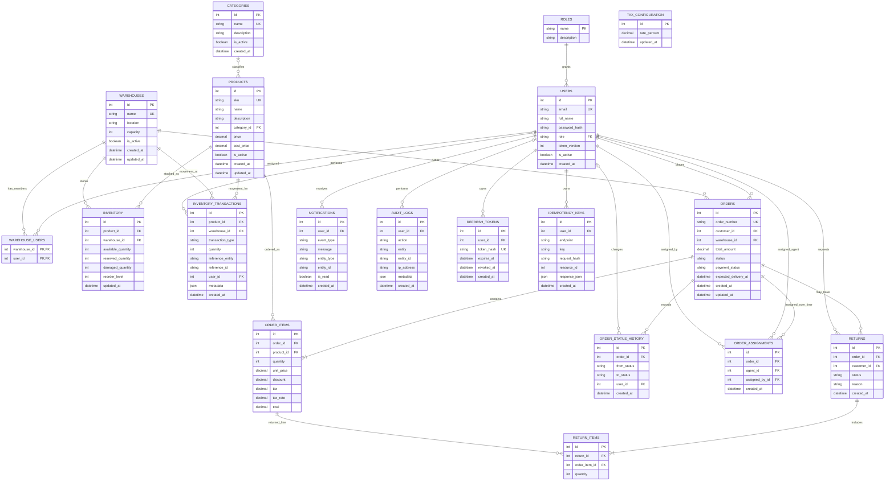

# Entity-Relationship Diagram

This diagram reflects the SQLAlchemy models and database foreign keys currently
implemented in the platform. Mermaid-capable Markdown viewers render the diagram
below.

## Relationship and integrity notes

- `warehouse_users` is the many-to-many join table between users and warehouses.
  Its `(warehouse_id, user_id)` composite primary key prevents duplicate
  membership rows.
- `inventory` stores one balance row per product and warehouse. The
  `(product_id, warehouse_id)` pair is unique, and each quantity field must be
  non-negative.
- `inventory_transactions` is the inventory movement ledger. `reference_entity`
  and `reference_id` are descriptive polymorphic reference fields, not foreign
  keys. The API does not expose ledger mutation routes.
- `order_items` preserve unit price, discount, tax rate, tax, and total as
  snapshots. An order must contain one or more items when created through the
  API.
- `order_assignments` preserves assignment history; the latest assignment row
  identifies the currently assigned agent.
- `return_items` link requested return quantities to purchased `order_items`.
  The `(return_id, order_item_id)` pair is unique.
- `notifications.entity_type`/`entity_id` and
  `audit_logs.entity`/`entity_id` are polymorphic references and are not
  database foreign keys.
- Payment is currently a status on `orders` (`payment_status`); there is no
  separate payment table or external payment-provider entity.
- `tax_configuration` is a singleton configuration table constrained to `id=1`.
- Foreign-key deletion behavior is defined in the SQLAlchemy models. For
  example, deleting a user cascades their refresh tokens, notifications, and
  idempotency keys; referenced business records generally restrict deletion.

## Entity coverage

The diagram includes identity and role data, warehouse membership, catalog,
inventory balances and ledger transactions, orders and lifecycle history,
fulfillment assignments, return requests and lines, notifications, audit logs,
refresh tokens, idempotency keys, and tax configuration.
